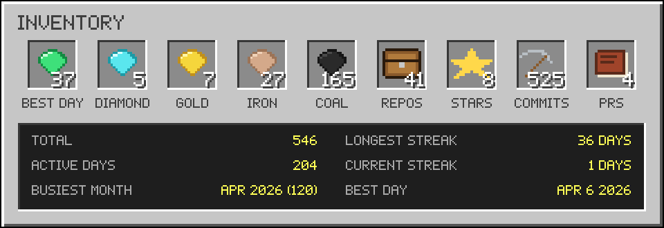
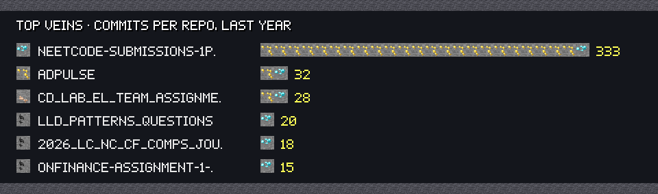
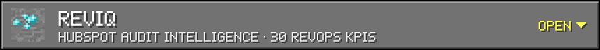
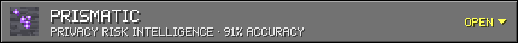
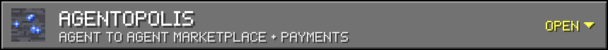
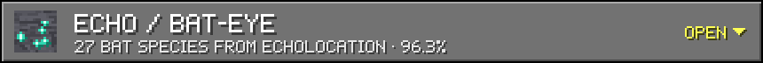
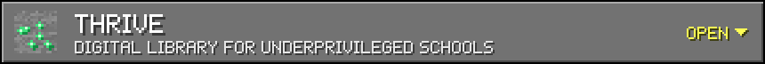

<p align="center">
  <a href="https://pvjambur.github.io/pvjambur/"></a>
</p>

<p align="center">
  <a href="https://pvjambur.github.io/pvjambur/"></a>
</p>

<!-- LINKS:START -->
<p align="center">
  <a href="https://pvjambur.github.io/pvjambur/"></a>
  <a href="https://pranavjambur.com/"></a>
  <a href="https://www.linkedin.com/in/pranavvjambur/"></a>
  <a href="mailto:jambur.pranav@gmail.com"></a>
  <a href="https://leetcode.com/u/pvj123/"></a>
  <a href="https://codeforces.com/profile/pranavvj123"></a>
</p>
<!-- LINKS:END -->

<!-- ASCII:START -->
```text
██████╗ ██████╗  █████╗ ███╗   ██╗ █████╗ ██╗   ██╗
██╔══██╗██╔══██╗██╔══██╗████╗  ██║██╔══██╗██║   ██║
██████╔╝██████╔╝███████║██╔██╗ ██║███████║██║   ██║
██╔═══╝ ██╔══██╗██╔══██║██║╚██╗██║██╔══██║╚██╗ ██╔╝
██║     ██║  ██║██║  ██║██║ ╚████║██║  ██║ ╚████╔╝
╚═╝     ╚═╝  ╚═╝╚═╝  ╚═╝╚═╝  ╚═══╝╚═╝  ╚═╝  ╚═══╝
     ██╗ █████╗ ███╗   ███╗██████╗ ██╗   ██╗██████╗
     ██║██╔══██╗████╗ ████║██╔══██╗██║   ██║██╔══██╗
     ██║███████║██╔████╔██║██████╔╝██║   ██║██████╔╝
██   ██║██╔══██║██║╚██╔╝██║██╔══██╗██║   ██║██╔══██╗
╚█████╔╝██║  ██║██║ ╚═╝ ██║██████╔╝╚██████╔╝██║  ██║
 ╚════╝ ╚═╝  ╚═╝╚═╝     ╚═╝╚═════╝  ╚═════╝ ╚═╝  ╚═╝

  > loading world "pvjambur" ...
  [########################################] 100%

  generating terrain ............... 367 days
  placing ore ...................... 566 contributions
  richest vein ..................... 2026-04-06 (37)
  longest tunnel ................... 36 day streak
  diamond days ..................... 5
  hidden chests .................... 7 projects
  player status .................... AI and Software Engineer Intern @ ScaleStation
```
<!-- ASCII:END -->

<p align="center">
  
</p>

<p align="center">
  
</p>

<p align="center">
  
</p>

### Chests

Click one to open it.

<!-- CHESTS:START -->
<details>
<summary></summary>

Solo built SaaS that audits 30 RevOps KPIs through HubSpot OAuth using five tuned XGBoost models, with 35 LangGraph agents behind a chat interface.

Stack: React, TypeScript, FastAPI, XGBoost, LangGraph, GCP  
[Open the demo](http://rev-iq-production-service.vercel.app/)

</details>

<details>
<summary></summary>

Marketing automation and CRM platform. Cuts ad creation from 60 minutes to under two with Gemini and Groq on an event driven Kafka and Airflow pipeline.

Stack: React, FastAPI, Supabase, Kafka, Airflow  
[Open the demo](https://ad-pulse-66bc.vercel.app/)

</details>

<details>
<summary></summary>

Privacy risk intelligence system that flags sensitive data exposure. 91% accuracy.

Stack: Python, ML  
[Open the repo](https://github.com/pvjambur/PRISMATIC)

</details>

<details>
<summary></summary>

A marketplace where AI agents negotiate with each other and settle payments.

Stack: TypeScript  
[Open the repo](https://github.com/pvjambur/Agentopolis)

</details>

<details>
<summary></summary>

Classifies 27 bat species from echolocation spectrograms at 96.3% accuracy in 8 seconds, against 45 minutes by hand. I own the ML pipeline.

Stack: Azure ML, PyTorch, bioacoustics  
[Open the demo](https://pulse.wildsynapse.com/)

</details>

<details>
<summary></summary>

Builds personalised course maps from a learner's topic, language and baseline, with hint based tutoring that works offline.

Stack: LLM sequencing, multilingual, offline first  
[Open the demo](https://thrive-learn.vercel.app/)

</details>

<details>
<summary></summary>

Encrypted multi-user communication using polarised photons over fibre optics and Li-Fi.

Stack: Python, Jupyter  
[Open the repo](https://github.com/pvjambur/Quantum_Nodal_Cryptography)

</details>

<details>
<summary></summary>

- ScaleStation, AI and Software Engineer Intern (Now). HubSpot native agentic platform on FastAPI, React and LangGraph with self learning loops. Backend services, Slack integrations and CI/CD across revenue operations.
- BitGo, Software Engineering Intern (From January). Incoming.
- DRDO (CASDIC), Full Stack Intern (Mar to Jul 2026). Classified defence system under CASDIC supervision, delivering secure frontend and backend services.
- Unisys, AI Research Intern (Jun 2025 to Feb 2026). CrewAI multi agent workflows automating 14 processes and 500 tickets a day, cutting resolution time by 35%.
- SpikedAI, AI Engineer Intern (Mar 2025 to Jan 2026). AWS and WebRTC video platform at 87 ms latency, 92% faster, with a copilot raising productivity 42%.
- IISc, Research Intern (Jun to Sept 2025). LSTM healthcare monitoring at 92% fall detection accuracy, cutting emergency response time 78%.
- IEEE Bengaluru Section, Research Intern (Apr to Nov 2025). Human feedback driven data science workflows using LangChain SQL agents, MCP and Qdrant vector search.

</details>

<details>
<summary></summary>

- Five IEEE publications, mostly applied ML
- Two Springer Nature chapters in CODE-AI 2025 (MAHE Dubai)
- Best Paper Award, IEEE CSITSS 2024, for quantum encryption and Li-Fi work
- 1400 problems solved. LeetCode 1931, CodeChef 1566, Codeforces Pupil 1403
- Vice President, IEEE RVCE; Joint Secretary, IEEE Computer Society RVCE; HackRVCE 2024 organiser
- Top 20 finalist, IndiaAI CyberGuard Hackathon (Ministry of Home Affairs, 2025); first place, IUCEE Ideathon and AI Debate (2024)
- Helped run MedCypher with Bangalore Medical College

</details>
<!-- CHESTS:END -->

<br>

<p align="center">
  <sub>Every image on this page is redrawn twice a day from my real GitHub data by <a href=".github/workflows/mine.yml">a small Action</a>. The full game lives <a href="https://pvjambur.github.io/pvjambur/">here</a>.</sub>
</p>
